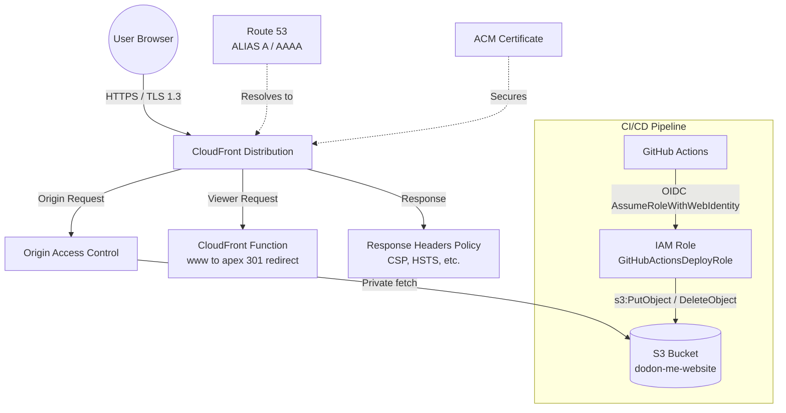

# 🌐 AWS CloudFront Static Site Infrastructure

[](https://github.com/Ernelson123/cloudfront-project/actions/workflows/deploy.yml)
[](LICENSE)

A secure, fully automated static website hosted on AWS. The project demonstrates cloud architecture patterns such as a private S3 origin, strict security headers, edge redirects, and secretless CI/CD deployments through AWS IAM OIDC.

**Live site:** [https://dodon.me](https://dodon.me)

---

## 🏗️ Architecture Overview



---

## 🚀 Key Features & Engineering Decisions

### 🔒 Security

- **No stored secrets:** GitHub Actions authenticates to AWS using OIDC and receives short-lived credentials. No long-lived access keys exist in the repository.
- **Private origin:** The S3 bucket is not public. CloudFront reads it exclusively through an Origin Access Control (OAC).
- **Scoped trust policy:** The IAM role can only be assumed by this repository's `main` branch, with the token audience pinned to `sts.amazonaws.com`.
- **Security headers:** A custom CloudFront Response Headers Policy sets:
  - `Content-Security-Policy` with a strict `'self'` policy (no inline scripts or styles)
  - `Strict-Transport-Security` (HSTS)
  - `X-Frame-Options: DENY` and `X-Content-Type-Options: nosniff`
  - `Permissions-Policy` restricting camera, microphone and geolocation

### ⚡ Performance & Networking

- **Global CDN:** CloudFront distribution using an EU/NA price class.
- **Dual-stack DNS:** Route 53 `ALIAS` records for both `A` (IPv4) and `AAAA` (IPv6).
- **Canonical domain:** A CloudFront Function redirects `www.dodon.me` to `dodon.me` with a `301` at the edge.

### 🛠️ Custom Tooling

`infra-check` is a multi-command Go CLI (`tools/infra-check/`) that validates the live infrastructure:

| Command | What it checks |
|---------|----------------|
| `dns` | Route 53 delegation and ALIAS resolution |
| `tls` | ACM certificate chain and TLS 1.3 handshake |
| `cache` | CloudFront `X-Cache` behaviour (Hit / Miss / RefreshHit) |
| `headers` | Presence and correctness of the security headers |

---

## 📂 Project Structure

```text
.
├── .github/workflows/
│   └── deploy.yml          # Secretless CI/CD pipeline (AWS IAM OIDC)
├── site/
│   ├── index.html          # Static homepage (no inline scripts or styles)
│   └── style.css           # External stylesheet
├── tools/infra-check/
│   ├── main.go             # CLI entrypoint
│   ├── dns.go              # DNS validator
│   ├── tls.go              # TLS certificate validator
│   ├── cache.go            # CloudFront cache validator
│   └── headers.go          # Security headers validator
├── PROGRESS.md             # Engineering log of all phases
└── README.md               # This file
```

---

## 🧪 How to Validate

Clone the repository and run the Go tooling against the live site (requires Go installed):

```bash
# 1. Verify DNS and dual-stack ALIAS records
go run ./tools/infra-check dns dodon.me

# 2. Validate the TLS 1.3 handshake and ACM certificate
go run ./tools/infra-check tls dodon.me

# 3. Check CloudFront edge caching behaviour
go run ./tools/infra-check cache dodon.me

# 4. Assert security headers compliance
go run ./tools/infra-check headers dodon.me
```

---

## 🔐 CI/CD with OIDC

Every push to `main` triggers `.github/workflows/deploy.yml`, which:

1. Requests an OIDC token from GitHub (`permissions: id-token: write`).
2. Assumes `GitHubActionsDeployRole` through `sts:AssumeRoleWithWebIdentity`.
3. Syncs the `site/` folder to the S3 bucket.

**Lesson learned:** GitHub's OIDC `sub` claim now includes numeric owner and repository IDs
(`repo:<owner>@<owner-id>/<repo>@<repo-id>:ref:refs/heads/main`), so a trust policy written for the
classic `repo:<owner>/<repo>:*` format is rejected with `Not authorized to perform sts:AssumeRoleWithWebIdentity`.
The failing claim was identified through the CloudTrail `AssumeRoleWithWebIdentity` event.

---

## 📜 Project Phases (Engineering Log)

The repository was built iteratively, with each architectural decision documented in [PROGRESS.md](PROGRESS.md):

- **Phases 1-3:** Account hardening, IAM least privilege, private S3 bucket.
- **Phases 4-5:** Route 53 domain delegation, CAA records, ACM TLS provisioning.
- **Phases 6-7:** CloudFront distribution, OAC, dual-stack ALIAS, Response Headers Policy.
- **Phase 8:** Custom `infra-check` Go CLI for automated validation.
- **Phase 9:** Secretless CI/CD with GitHub Actions and AWS IAM OIDC.
- **Phase 10 (in progress):** Migration of manual console configuration to Terraform (IaC).

---

## 🤖 AI Assistance

This project was built as a hands-on learning exercise, with AI assistants (such as Claude, Qwen and GitHub Copilot) used as a guide and pair-programming aid. They helped with:

- Explaining AWS concepts and architecture options
- Drafting configuration, code and documentation (including this README)
- Debugging, for example the OIDC trust policy error described above

I deployed and configured everything myself in my own AWS account, reviewed the generated output, and tested the result with the `infra-check` tool.

---

## 👤 Author

**Ernelson Barros**
[GitHub](https://github.com/Ernelson123)

Built with AWS, Go, and GitHub Actions.